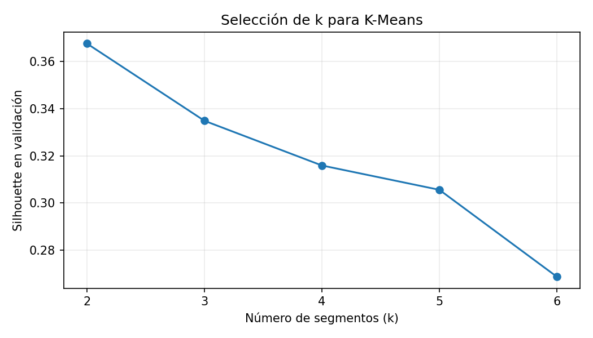
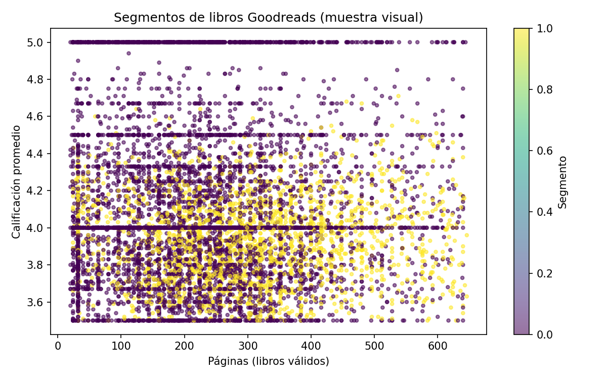

# Hallazgos — Actividad 3: segmentos de libros Goodreads

**Pregunta:** Entre los libros de Goodreads con calificacion promedio igual o superior a 3.5, que perfiles de extension fisica y participacion de lectores se pueden identificar para orientar como una libreria distribuye su espacio de exhibicion y prioriza su curaduria?

El análisis se plantea para el equipo de compras y exhibición de Librerías Plaza Lectura, en un escenario académico hipotético.

## Resultado del modelo

K-Means seleccionó **k = 2** entre los valores probados (2, 3, 4, 5, 6), usando silhouette en una muestra de validación que no participó en el ajuste.
- Silhouette de validación: **0.368**.
- Davies–Bouldin de validación: **1.078** (menor suele indicar segmentos más compactos y separados).
- Silhouette cerca de 1 indica segmentos compactos y separados; cerca de 0 indica solapamiento. La separación es moderada; los perfiles sirven como hipótesis de curaduría que conviene validar con datos reales de ventas e inventario.

## Perfiles identificados

|   segmento | perfil                               |   libros |   participacion_pct |   paginas_mediana |   calificacion_media |   calificaciones_mediana |   resenas_mediana |   series_pct | editoriales_top                                                                        | idiomas_top                                                   |
|-----------:|:-------------------------------------|---------:|--------------------:|------------------:|---------------------:|-------------------------:|------------------:|-------------:|:---------------------------------------------------------------------------------------|:--------------------------------------------------------------|
|          0 | menor extensión, menor participación |   157869 |               72.15 |            218.00 |                 4.11 |                     8.00 |              1.00 |        11.66 | Routledge (2,815); Oxford University Press (1,944); Cambridge University Press (1,873) | English (136,977); Spanish; Castilian (3,988); French (3,737) |
|          1 | mayor extensión, mayor participación |    60948 |               27.85 |            288.00 |                 3.93 |                  1711.00 |            129.00 |        37.73 | HarperCollins (547); Ballantine Books (417); Bantam (415)                              | English (45,467); Spanish; Castilian (3,084); French (2,608)  |

El segmento **0** es el más numeroso (72.1% de los registros) y su perfil es *menor extensión, menor participación*, con una mediana de 218 páginas y 8 calificaciones por libro.
El segmento **1** registra la mayor mediana de participación (1711 calificaciones y 129 reseñas por libro); su perfil es *mayor extensión, mayor participación*.

La proporción de libros de cada segmento puede servir como punto de partida para conversar sobre curaduría y exhibición. No equivale directamente a metros lineales de estante: el dataset no contiene dimensiones físicas del mobiliario, ventas ni disponibilidad local.

## Recomendación y límites

Empezar la conversación de exhibición con el segmento más numeroso (0, 72.1%) y revisar por separado el segmento con mayor participación de lectores (1). Contrastar ambos perfiles con ventas, rotación, costos, idioma y espacio real antes de cambiar compras o estantes. Las editoriales e idiomas de la tabla son descripciones posteriores de cada segmento, no variables que determinaron los grupos.

El análisis se limita al split `train` de `pfaha/goodreads-books` y a calificaciones >= 3.5; por tanto, no describe todos los libros ni la demanda de una librería. K-Means depende de las variables, los filtros, el escalado y la semilla. Los perfiles son asociaciones descriptivas, no causas.

Los valores de este documento se generan desde la misma ejecución que `actividad3_goodreads.txt`; no deben reemplazarse por cifras copiadas de ejecuciones anteriores.
